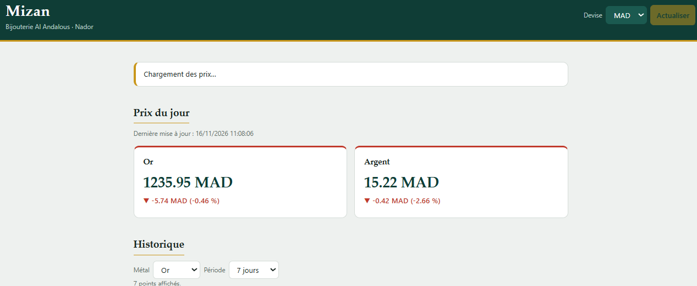
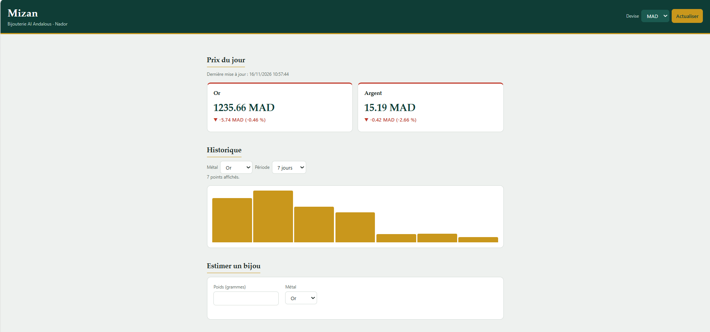
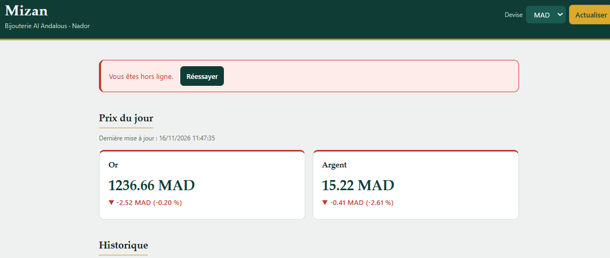

# Mizan

Application web (HTML, CSS et JavaScript vanilla en modules ES) qui affiche le cours de l'or et de l'argent
pour la bijouterie **Al Andalous** (Nador). Elle remplace les trois sites que le patron ouvrait chaque matin :
un seul écran montre les prix du jour, leur variation, un historique et un estimateur de bijou.

**Démo :** À COMPLÉTER (lien GitHub Pages ou vidéo)

## Lancer le projet

Les modules ES et `fetch` ne fonctionnent pas depuis `file://`. Il faut un petit serveur local :

- extension **Live Server** de VS Code (clic droit sur `index.html` > *Open with Live Server*), ou
- `python3 -m http.server 8000` puis ouvrir `http://localhost:8000`.

Aucune installation, aucune clé d'API.

## Structure

```
index.html          structure de la page, template de carte
css/style.css       styles (variables, cartes, graphique, états)
js/api.js           service : tous les appels réseau et la gestion des erreurs
js/change.js        calcul de la variation (fonction pure)
js/estimator.js     estimation d'un bijou et validation du poids (fonctions pures)
js/main.js          affichage et événements
samples/            réponses réelles de l'API pour tester hors-ligne
screenshots/        captures des états chargement, succès et erreur
```

`api.js` est le seul module qui parle au réseau. `change.js` et `estimator.js` ne touchent pas au DOM.

## API utilisée : xaus.com

Aucune clé n'est nécessaire.

| Endpoint | Paramètres | Utilisé pour |
|---|---|---|
| `GET https://xaus.com/api/v1/spot` | `currency` (MAD, USD, EUR), `unit=gram`, `compact=1` | prix courants, taux de change, horodatage |
| `GET https://xaus.com/api/v1/chart` | `symbol` (`xau` ou `silver`), `range=1mo`, `interval=1d` | historique journalier et variation |

Champs utilisés dans `/spot` : `xau.price` (or, déjà dans la devise demandée, par gramme), `silver_usd_oz`
(argent en USD par once troy), `fx_rate` (taux USD vers la devise) et `updated_at`.
Dans `/chart`, chaque point contient `t` (timestamp en secondes) et `c` (cours de clôture du jour).

Exemples de réponses réelles dans `samples/`.

### Pourquoi xaus.com et pas goldprice.dev

Le brief cite goldprice.dev, mais son endpoint `/v1/convert` ne gère pas le dirham :
la requête `convert?from=XAG&to=MAD` renvoie un code 400 avec `unsupported_currency`
(voir `samples/goldpricedev-mad-error.json`). Comme Hassan veut les prix en dirhams,
j'ai utilisé xaus.com, qui fournit l'or en MAD et le taux de change nécessaire pour l'argent.

## Fonctionnalités

- **Prix du jour (US-01, US-02)** : une carte par métal, générée en boucle sur un tableau, avec prix,
  variation en valeur et en pourcentage, flèche et couleur (vert si hausse, rouge si baisse),
  et horodatage de la dernière mise à jour.
- **Choix de la devise (US-03)** : MAD, USD ou EUR. Un changement relance une requête.
  La devise est conservée dans `localStorage`.
- **Historique (US-04)** : graphique en barres (7 ou 30 jours) construit sans librairie.
  Les barres sont mises à l'échelle entre le minimum et le maximum des points reçus.
  Le nombre de points affichés est indiqué, car l'API n'en renvoie qu'une vingtaine par mois
  (pas de cotation le week-end).
- **Estimateur de bijou (US-05)** : poids en grammes + métal. Le calcul (`estimateValue`) et la
  validation (`parseWeight`) sont des fonctions pures. Les saisies vides, négatives, nulles ou non numériques
  sont refusées avec un message sous le champ. La virgule est acceptée (`12,5`).
- **États et erreurs (US-06)** : chargement, succès, erreur. Les erreurs sont distinguées dans `api.js`
  (hors-ligne, réseau, quota dépassé, code HTTP, JSON illisible). Le bouton « Réessayer » relance la requête
  et les boutons sont désactivés pendant le chargement.

Le journal des requêtes (US-07, bonus) n'est pas implémenté.

## Choix techniques

- **Modules ES** : le réseau (`api.js`), les calculs (`change.js`, `estimator.js`) et l'affichage (`main.js`) sont séparés.
- **`textContent` partout** : aucune donnée venue du réseau n'est insérée avec `innerHTML`.
- **Cartes générées depuis un tableau** : un `<template>` HTML est cloné pour chaque métal.
  Les listes de métaux des deux sélecteurs viennent aussi de ce tableau, rien n'est écrit en dur dans le HTML.
- **Pas de rafraîchissement automatique** : un bouton « Actualiser » suffit et respecte le quota.
- **Constante `31.1035`** : nombre de grammes dans une once troy, utilisée pour convertir l'argent.

## Difficultés rencontrées et solutions

| Difficulté | Solution |
|---|---|
| goldprice.dev n'accepte pas le dirham (`unsupported_currency`) | Changement d'API pour xaus.com |
| L'argent n'est fourni qu'en USD par once | Conversion : `silver_usd_oz / 31.1035 * fx_rate` |
| L'API ne fournit pas la variation | Calcul à partir des deux derniers points de `/chart` (`computeChange`) |
| Une réponse 429 est vide, donc `response.json()` plante | Le code 429 est testé avant la lecture du JSON |
| Une réponse 404 sans en-tête CORS est vue par le navigateur comme une erreur réseau | Noté pour les tests d'erreur : l'erreur « serveur » se teste avec un autre code que 404 |
| L'historique se chargeait avant le remplissage du sélecteur de métal | Appel de `loadHistory()` dans `loadPrices`, après le remplissage des sélecteurs |
| Moins de points que demandé (week-end) | Le graphique s'adapte et affiche le nombre de points reçus |

## États de l'application

| Chargement | Succès | Erreur (hors-ligne) |
|---|---|---|
|  |  |  |

Ces états ont été testés avec l'onglet Réseau des DevTools (*Slow 3G* et *Offline*).

## Limites et pistes d'amélioration

- Journal des requêtes (US-07) à ajouter.